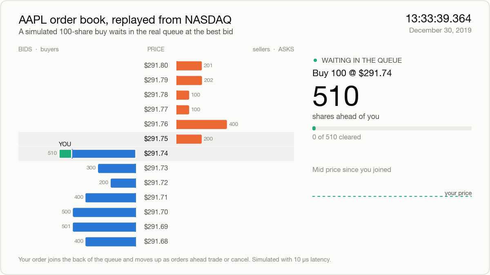
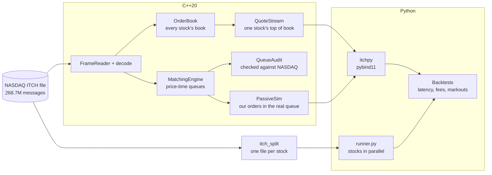
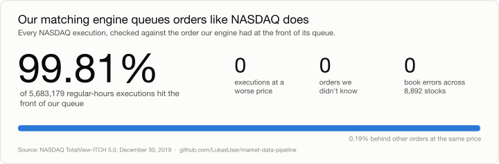
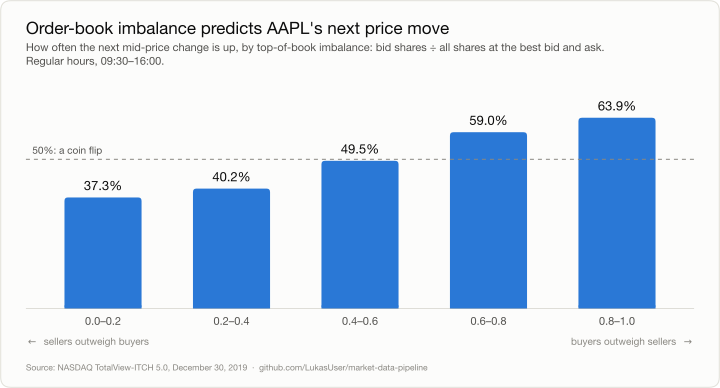
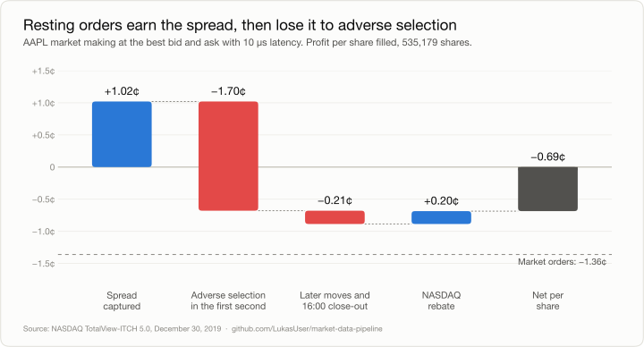
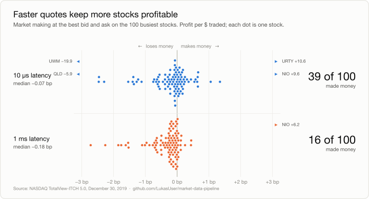

# Market Data Pipeline

[](https://github.com/LukasUser/market-data-pipeline/actions/workflows/ci.yml)

A C++20 and Python research pipeline on raw NASDAQ TotalView-ITCH 5.0 data. It
rebuilds every stock's order book, matches orders with price-time priority, and
backtests trading strategies with realistic latency, fees and queue position.

<picture>
  <source media="(prefers-color-scheme: dark)" srcset="docs/img/order-book-dark.gif">
  
</picture>

*A simulated buy joins AAPL's real queue behind 510 shares, then is filled when a
seller sweeps the whole level and the price drops through it: adverse selection
in five seconds.*

## How it works



## Highlights

Full trading day, 2019-12-30:

| | |
|---|---|
| Replay | 268.7M messages, 8,892 stocks, **0 errors**; every book empty at the close |
| Decode speed | 54.7M messages/s (1.68 GB/s) |
| Queue model vs NASDAQ | **99.81%** of 5.7M executions hit the front of our queue |
| Market orders, AAPL | −1.36¢/share: pays the spread |
| Resting orders, AAPL | +1.02¢ spread captured, −1.70¢ adverse selection after 1 s |
| 100 stocks, 10 µs latency | 39 of 100 profitable (16 of 100 at 1 ms) |
| Splitting by stock | 47× faster per job; 400 backtests in 21 CPU-minutes |

## Results

<picture>
  <source media="(prefers-color-scheme: dark)" srcset="docs/img/queue-audit-dark.svg">
  
</picture>

The matching engine's queues agree with how NASDAQ actually filled orders, so
queue position can be trusted in the backtests below.

<picture>
  <source media="(prefers-color-scheme: dark)" srcset="docs/img/imbalance-dark.svg">
  
</picture>

Imbalance is a real signal, but trading it with market orders loses about half
the spread (−1.36¢) on every share.

<picture>
  <source media="(prefers-color-scheme: dark)" srcset="docs/img/pnl-waterfall-dark.svg">
  
</picture>

Resting orders do earn the spread, but fills tend to come just before the
price moves against them.

<picture>
  <source media="(prefers-color-scheme: dark)" srcset="docs/img/stocks-dark.svg">
  
</picture>

Most stocks land within a basis point of zero either way; slower quotes shift
the whole distribution into losses.

**Limitations:** one day of data, no market impact, and fills only at the best
price. 0.19% of executions skip ahead of our queue for reasons not yet found.

## Repo layout

```
include/itch/     C++ headers
src/              C++ implementation
tools/            Command-line tools (itch_stats, itch_book, itch_queue, itch_rank, itch_split)
python/           itchpy bindings, backtest.py, market_making.py, runner.py
python/examples/  Research scripts: spread, imbalance, make_markets, visuals
tests/            GoogleTest suite (C++); python/tests/ has the Python tests
docs/img/         README images, generated by python/examples/visuals.py
```

| Component | What it does |
|---|---|
| `FrameReader`, `decode` | Zero-copy framing; strict decoding of the 7 book messages (A F E C X D U) |
| `OrderBook`, `Market` | One book per stock: hash map of orders, sorted price levels |
| `MatchingEngine` | Price-time priority; per-order queues with O(1) cancel |
| `QueueAudit` | Checks NASDAQ's executions against the engine's queues |
| `QuoteStream`, `PassiveSim` | One stock's top of book; our resting orders in the real queues |
| `itchpy` | pybind11 bindings for all of the above |
| `backtest.py`, `market_making.py` | Event-driven backtests: latency, fees, rebates, markouts |
| `itch_split`, `runner.py` | Split a day by stock; run jobs across cores, resume after interruption |
