<a href="https://lukas-nilsson.com/blog/market-data-pipeline/">
  <picture>
    <source media="(prefers-color-scheme: dark)" srcset="docs/img/banner-dark.svg">
    
  </picture>
</a>

<a href="https://lukas-nilsson.com/blog/market-data-pipeline/">How it works, one decision at a time</a>

